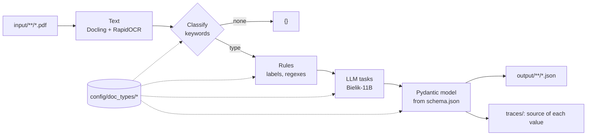

# Odwołania2json

Converts each PDF of a KIO appeal case into JSON in the UZP format: PDF → text (Docling, OCR for scans) → document type (`odwolanie`, `pelnomocnictwo`, `przelew`, else `{}`) → fields (config rules + a small LLM) → validated JSON with the source of every value.

> [!TIP]
> **Start here: [walkthrough.ipynb](walkthrough.ipynb)** – the whole solution step by step on real documents: text extraction, document type, rules, LLM, provenance of every value, and the evaluation on all 226 documents (F1 0.954). Saved with outputs, so it reads without running; to run it: `python -m notebook walkthrough.ipynb`.



## Quickstart

Python 3.13+, CPU only. The LLM runs over an EU-hosted API (PSNC, Poznań).

```bash
python3 -m venv .venv && source .venv/bin/activate
pip install -r requirements.txt
echo "LLM_API_KEY=<key>" > .env
python -m src.run
```

- First run downloads Docling models (~0.7 GB) into `models/`.
- No `LLM_API_KEY`: the LLM step is skipped with a warning; rules fill every field (F1 0.950 vs 0.954).

## Usage

### Batch (challenge mode)

```
input/case1/odwolanie_nr_1.pdf   →   output/case1/odwolanie_nr_1.json
input/case1/scan.pdf             →   output/case1/scan.json     ({} if not a known type)
```

Any folder layout; non-PDF files are skipped. Settings are constants in `src/run.py` (`MODE`, `INPUT_DIR`, `OUTPUT_DIR`, `RUN_EXPERIMENT`).

### HTTP API

```bash
python -m uvicorn src.api:app --port 8000      # Swagger: http://localhost:8000/docs
curl -F "files=@input/case1/odwolanie.pdf" "http://localhost:8000/documents?experiment=hybrid-v1"
```

| Endpoint | Returns |
|---|---|
| `GET /health` | `{"status": "ok"}` |
| `GET /experiments` | pipeline variants (`hybrid-v1` default, `rules-v1` = no LLM) |
| `POST /documents` | per file: `doc_type`, `data` (output JSON), `classification_scores`, `sources` (provenance), `error` |

Uploads are processed in a temp folder; nothing is written to `output/`.

### Web UI

```bash
python -m streamlit run src/web_app.py         # http://localhost:8501, needs the API running
```

Upload PDFs, inspect JSON and value sources, download JSON or ZIP.

Example: `dane/przyklad_01/przelew.pdf` →

```json
{
  "przelew_bankowy": {
    "data_operacji": "2026-03-21",
    "kwota": 200.0,
    "na_rachunek": "68438223049992295262834736",
    "numer_transakcji": "CEN2604016344389",
    "tytul": "opłata skarbowa od pełnomocnictwa dla Aleksandra Marciniak i Jolanta Zajkowski w postępowaniu przed KIO w przetargu ZS.791.2026 CEN2604016344389",
    "z_rachunku": "05470680287581539721455024"
  }
}
```

## Documentation

| File | Contents |
|---|---|
| [walkthrough.ipynb](walkthrough.ipynb) | step-by-step walkthrough on real documents with evaluation results (saved with outputs; run: `python -m notebook walkthrough.ipynb`) |
| [docs/architecture.md](docs/architecture.md) | stages, data flow, provenance, design decisions |
| [docs/extensibility.md](docs/extensibility.md) | adding a document type or field with config only |
| [docs/infrastructure.md](docs/infrastructure.md) | components and licences, hardware, network, environment |
| [docs/evaluation.md](docs/evaluation.md) | F1 method, how to run evaluation, results |
| [docs/solution_overview.md](docs/solution_overview.md) | one-page pitch |
| [CLAUDE.md](CLAUDE.md) | coding rules for contributors and AI agents |

Challenge description: [Urzad-Zamowien-Publicznych/hacknation-2026](https://github.com/Urzad-Zamowien-Publicznych/hacknation-2026).
