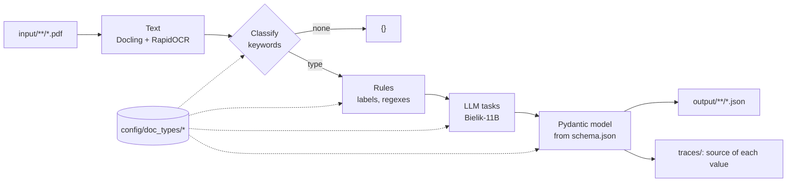

# Odwołania2json
Our system turns each PDF from an appeal case into JSON in the UZP format. Below is the path of a single document through the system:

1. Reading text from the PDF
In the first step, the document is processed with the open-source Docling library. We chose it because a single tool reads text, tables, page layout and reading order, so we don't have to combine several libraries. When a page is a scan without a text layer, a local OCR engine (RapidOCR) for Polish is used. It runs on the user's machine, because OCR through an external API would count as additional model usage. We process only the first two pages, because all the required data is there. As a result, even the longest scans, the appeal scans, are processed in about 6–8 s on a laptop with an Apple M4 processor and no GPU.

2. Based on the extracted text, the system determines whether the document is an appeal, a power of attorney or a payment confirmation. It sums the weights of keywords typical for each type and picks the one with the highest score, provided it exceeds a threshold. Otherwise it returns an empty JSON. Matching ignores letter case and Polish diacritics, so OCR errors do not affect the result. We deliberately do not use a language model here: keywords achieved 100% accuracy on 226 documents, cost zero tokens, and the decision is easy to explain, because you can see which phrases decided it. On the out-of-scope documents we tested, the system did not invent a single value.

3. Rule-based data extraction
Once the document type is known, the system reads the fields according to rules stored in the configuration. A rule says where to look for a value, e.g. after the label "Rachunek odbiorcy" (recipient account), and what type the value is. NIP, REGON, KRS, PESEL, bank account numbers, amounts, dates, and BZP and TED notice numbers all have a strictly defined format. That is why we check them with a pattern and a checksum, and then normalise them. For this kind of data, a rule is more accurate, faster and cheaper than a language model.

4. LLM where the content needs to be understood
Some information cannot be extracted with a pattern. Examples are which action of the contracting authority the appeal concerns, or converting a name from the genitive to the nominative case. Only in such places does the system send a short text snippet to the language model, asking about specific fields. The answer must match the JSON schema and appear in the document. If it doesn't, the rule-based value is kept or the field stays empty. We compared four open models available through the API of the Poznań Supercomputing and Networking Center (PSNC, llm.hpc.psnc.pl). We chose Bielik-11B because, despite being the smallest, it achieved the best result (F1 = 0.954) and outperformed the larger Mistral 24B and Qwen 27B models. We use temperature 0, so the same document always produces the same result. Without API access, the system keeps working in rules-only mode.

5. Building and validating the JSON
The extracted values go into a data model that is generated automatically from the schema.json file of the given document type. The model ensures the structure matches the format expected by UZP, fills missing fields with null, and validates the result before saving. Thanks to this, a new document type requires no code, only a schema.

6. Saving the result with the source of every value
Next to the output JSON, the system records where each value came from: whether it was read by a rule or by the model, from which page and from which text snippet. Every model request is stored together with its response. A clerk can therefore check every value against the source document instead of taking the system's word for it.

Extensibility, quality and usage
Adding a new document type comes down to creating a folder with two configuration files. The first describes the output structure; the second defines keywords, field rules and an optional task for the model. We tested this on BZP and TED notices: the system recognised all of them without changing any code. We measure quality with our own F1 evaluator. It reports results separately for digital documents, scans and out-of-scope documents, and every report contains the full configuration, so it can be reproduced. On the organiser's 226 documents we achieve F1 = 0.954. All measurements were taken on a MacBook Air laptop with an Apple M4 processor (10 cores, conversion on 4 threads) and 16 GB of RAM, without a GPU. A digital document takes on average 0.4 s to process and a scan 3.4 s (at most 7.1 s). Peak memory usage is about 4.8 GB. The system processed a batch of 150 PDF files in under 9 minutes. It can be used in batch mode, through a REST API, or through a web interface. In the interface you upload PDF files, view the result together with the source of every value, and download the finished JSON files. All components are open source.

> [!TIP]
> **Start here: [walkthrough.ipynb](walkthrough.ipynb)** – the whole solution step by step on real documents: text extraction, document type, rules, LLM, provenance of every value, and the evaluation on all 226 documents (F1 0.954). Saved with outputs, so it reads without running; to run it: `python -m notebook walkthrough.ipynb`.



## Quickstart

Python 3.13+, CPU only. The LLM runs over an EU-hosted API (PSNC, Poznań).

```bash
python3 -m venv .venv && source .venv/bin/activate
pip install -r requirements.txt
echo "LLM_API_KEY=<key>" > .env
python -m src.run
```

- First run downloads Docling models (~0.7 GB) into `models/`.
- No `LLM_API_KEY`: the LLM step is skipped with a warning; rules fill every field (F1 0.950 vs 0.954).

## Usage

### Batch (challenge mode)

```
input/case1/odwolanie_nr_1.pdf   →   output/case1/odwolanie_nr_1.json
input/case1/scan.pdf             →   output/case1/scan.json     ({} if not a known type)
```

Any folder layout; non-PDF files are skipped. Settings are constants in `src/run.py` (`MODE`, `INPUT_DIR`, `OUTPUT_DIR`, `RUN_EXPERIMENT`).

### HTTP API

```bash
python -m uvicorn src.api:app --port 8000      # Swagger: http://localhost:8000/docs
curl -F "files=@input/case1/odwolanie.pdf" "http://localhost:8000/documents?experiment=hybrid-v1"
```

| Endpoint | Returns |
|---|---|
| `GET /health` | `{"status": "ok"}` |
| `GET /experiments` | pipeline variants (`hybrid-v1` default, `rules-v1` = no LLM) |
| `POST /documents` | per file: `doc_type`, `data` (output JSON), `classification_scores`, `sources` (provenance), `error` |

Uploads are processed in a temp folder; nothing is written to `output/`.

### Web UI

```bash
python -m streamlit run src/web_app.py         # http://localhost:8501, needs the API running
```

Upload PDFs, inspect JSON and value sources, download JSON or ZIP.

Example: `dane/przyklad_01/przelew.pdf` →

```json
{
  "przelew_bankowy": {
    "data_operacji": "2026-03-21",
    "kwota": 200.0,
    "na_rachunek": "68438223049992295262834736",
    "numer_transakcji": "CEN2604016344389",
    "tytul": "opłata skarbowa od pełnomocnictwa dla Aleksandra Marciniak i Jolanta Zajkowski w postępowaniu przed KIO w przetargu ZS.791.2026 CEN2604016344389",
    "z_rachunku": "05470680287581539721455024"
  }
}
```

## Documentation

| File | Contents |
|---|---|
| [walkthrough.ipynb](walkthrough.ipynb) | step-by-step walkthrough on real documents with evaluation results (saved with outputs; run: `python -m notebook walkthrough.ipynb`) |
| [docs/architecture.md](docs/architecture.md) | stages, data flow, provenance, design decisions |
| [docs/extensibility.md](docs/extensibility.md) | adding a document type or field with config only |
| [docs/infrastructure.md](docs/infrastructure.md) | components and licences, hardware, network, environment |
| [docs/evaluation.md](docs/evaluation.md) | F1 method, how to run evaluation, results |
| [docs/solution_overview.md](docs/solution_overview.md) | one-page pitch |
| [CLAUDE.md](CLAUDE.md) | coding rules for contributors and AI agents |

Challenge description: [Urzad-Zamowien-Publicznych/hacknation-2026](https://github.com/Urzad-Zamowien-Publicznych/hacknation-2026).
