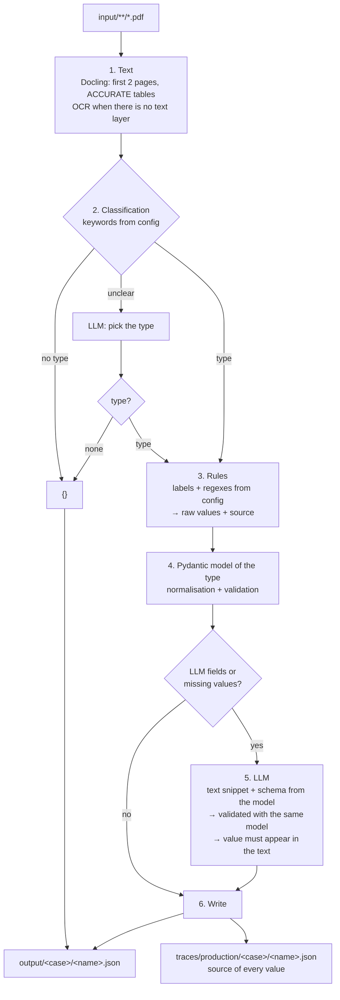
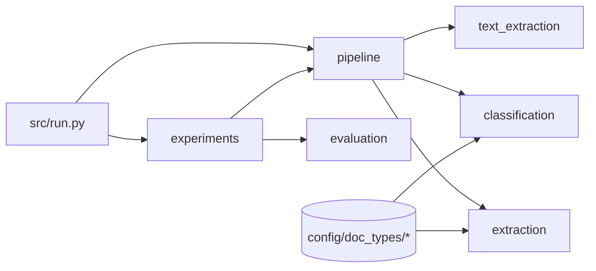
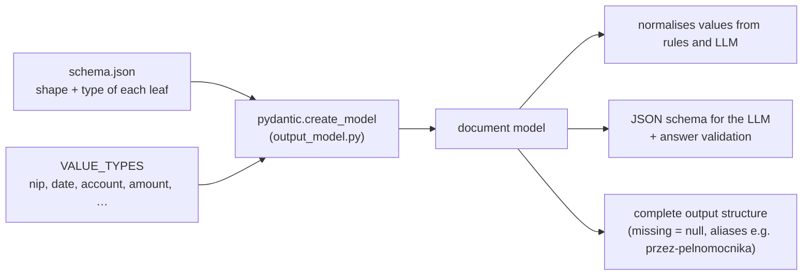
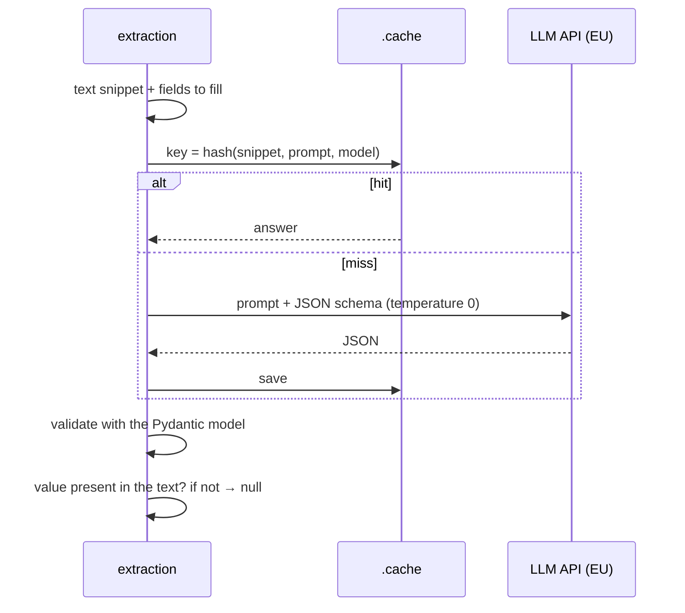
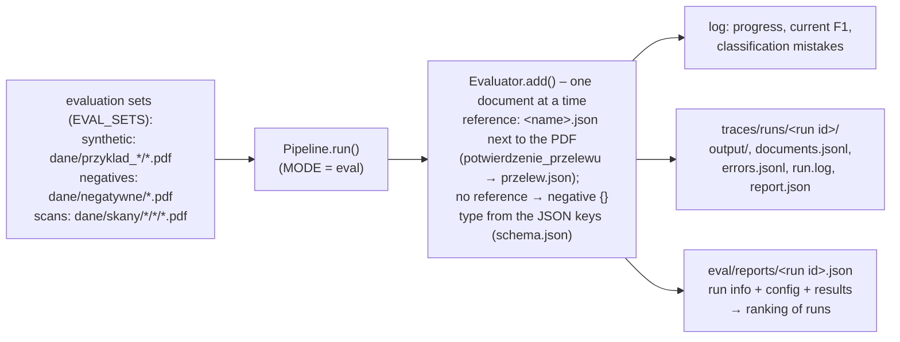

# Odwołania2json architecture

How the solution is built. Knowledge about document types lives in `config/`; the code is generic.

## 1. Goal and constraints

- Input: PDFs in `input/`, in any folder layout (other files are skipped) → output: `output/<same path>/<same name>.json`.
- Types: `odwolanie`, `pelnomocnictwo`, `przelew`; any other document → `{}`.
- Scoring: F1 on a hidden set of **real** cases (training data is synthetic), smaller LLM = more points, new types via configuration only, transparent extraction.
- Python 3.13, CPU only, 16 GB RAM, LLM via an API hosted in the EU/EEA.

Rule: **rules first, LLM only where judgement is needed or the rules failed.**

## Running

```bash
python -m src.run                                   # batch: input -> output (MODE and experiments in src/run.py)
python -m uvicorn src.api:app --port 8000           # API; Swagger: http://localhost:8000/docs
python -m streamlit run src/web_app.py              # UI (http://localhost:8501), needs the API running
```

The API and UI use the same experiments as `src/run.py` (default `RUN_EXPERIMENT`). Uploaded files are processed in a temporary folder; nothing goes to the output folder. The API handles one document at a time (a lock – the converter and LLM client are not thread-safe). Models load once, on the first request. The UI runs locally only (`.streamlit/config.toml`: localhost only, no usage statistics sent).

## 2. Document flow



If one file fails (broken PDF, API error): log it with the file name, write `{}`, move on to the next file.

## 3. Modules

| Step | Module | What it does |
|---|---|---|
| start | `src/run.py` | settings (`MODE`, `Workspace` with paths), list of experiments, logging |
| API | `src/api.py` | FastAPI: `POST /documents` (PDFs → JSON + value sources), `GET /experiments`, `GET /health`; Swagger at `/docs` |
| UI | `src/web_app.py` | Streamlit client for the API: upload PDFs, view JSON and value sources, download JSON/ZIP |
| loop | `src/pipeline/` | `Pipeline` (ABC: `from_config`, `process`; `run` measures time and handles errors), `PipelineConfig`, `InputDocument`/`DocumentResult` |
| 1 | `src/text_extraction/` | Docling, local models, OCR, conversion cache |
| 2 | `src/classification/` | scores types by keywords from config, LLM fallback |
| 3–5 | `src/extraction/` | output model from `schema.json` (`output_model.py`), rules from config (`rule_extractor.py`), LLM tasks from config (`llm_tasks.py`) |
| evaluation | `src/evaluation/` | compares with the reference, F1, values present in the text, conversion times (`Evaluator` works incrementally) |
| experiments | `src/experiments/` | `Experiment` (pipeline class + config), `ExperimentRunner`, run artifacts, report history and ranking |
| LLM | `src/inference/` | `LlmClient`: OpenAI-compatible API (PSNC, Bielik-11B), JSON answers following a Pydantic schema, answer cache, token counters |
| shared | `src/cache.py`, `src/doc_types.py`, `src/value_types.py`, `src/workspace.py` | disk cache, loading `config/doc_types/*`, value types with normalisers, paths |



Data flows one way. Stages pass typed objects to each other and do not import each other.

## 4. Document type configuration

```
config/doc_types/<type>/
  doc_type.toml    # classification (weighted keywords), text sections and field rules
  schema.json      # output JSON shape, exactly as the expected format; leaves = value type names
  prompt.md        # LLM instructions (only if the type has LLM fields)
```

The format is TOML (`tomllib` from the standard library – no extra dependency). The file is checked with a Pydantic model when it loads (`src/doc_types.py`): field paths must exist in `schema.json`, sections and fields that a rule uses must be defined, and regexes must compile. An error stops the program and shows the file path. Example (parts of real configs):

```toml
[classification]
min_score = 3                                   # minimum total weight to accept this type
[classification.keywords]                       # phrase → weight; negative weight = evidence against
"przelew" = 2

[sections.odwolujacy]                           # part of the text: from one label to another
start = ['odwolujac\w*\s*:']
end = ['zamawiaj\w*\s*:', 'dotyczy']

[fields."przelew_bankowy.z_rachunku"]           # a typed value (here: account) after one of the labels
labels = ["z rachunku", "rachunek nadawcy", "zleceniodawca"]
nth = 0                                         # no label found: first account in the text

[fields."Odwolujacy[].nazwa"]                   # text from the start of the section to the first cut
sections = ["odwolujacy"]
cut = ['\s+ul\.', '\s*\d{2}-\d{3}', '\s+(?:krs|nip|regon)\b']

[fields."mocodawca[].data.typ".classify]        # the value whose pattern matches first
osoba_fizyczna = ['prowadzac\w* dzialalnosc', 'ceidg']
osoba_prawna = ['\bsp\.\s?z\s?o\.\s?o\.', '\bkrs\b']
```

**Rule engine** (`src/extraction/rule_extractor.py`). It matches labels, sections and cuts against a "folded" copy of the text (lowercase, no Polish characters, same positions), so rules survive OCR losses. Values are read from the original text and normalised by their value type.

Ways to read a field (`FieldRule`):
- `lookup` – a table keyed by an earlier field's value (e.g. reason description by code),
- `classify` – the pattern that matches first,
- `labels` – the value after a label (labels tried in config order),
- otherwise – the start of the section.

The value is the first group of `pattern`, a candidate of the value type (date, amount, account, person name …), or the text to the end of the line (including wrapped lines). Options: `cut`, `skip`, `window`, `multiple` (`segment` – all people after a label, `occurrences` – after each match, e.g. each dotted signature line), `exclude`, `only_if`, `nth`, `default`. A label of a competing field of the same type ends the search window – this is how sender and recipient accounts are kept apart.

**Classifier** (`KeywordClassifier`). It looks for `keywords` in the first `pages` pages, and for `head_keywords` only in the document header (`head_chars` characters). The header is where a document says what it is: a KIO ruling starts with "Sygn. akt … WYROK", while real appeals quote rulings only later, in the reasoning. (We found this on scans – negative keywords searched in the whole text were rejecting real appeals.) Matching ignores case, whitespace and Polish accents (OCR drops them: "ODWOLANIE", "Odwołujacy"). The type with the highest total wins, if it reaches `min_score` and does not tie with another type.

**LLM tasks** (`[[llm_tasks]]`, model `LlmTaskRule`) are narrow questions asked after the rules, defined in the type's config:
- `extract` – asks about a context (the first section from the list that exists) for the given fields, in `decide` mode (a valid answer replaces the rule's value) or `fill` mode (only empty fields);
- `nominative` – converts surnames to the nominative case.

The answer schema is built from the value types (codes limited to `choices`). `when` runs a task only if a pattern matches (e.g. non-nominative endings in surnames). `lookup` fields (e.g. reason description) are recalculated after the LLM.

## 5. Data model (Pydantic)

Each normalisation rule lives in one place: value types in `src/value_types.py` (`VALUE_TYPES`). Each has a Python type, a normaliser, and a flag saying whether documents state the value directly (codes, flags and dictionary descriptions are interpreted). The leaves of `schema.json` name these types; an unknown name stops config loading.

| Type | Normalisation (example) |
|---|---|
| `date` | "24 września 2026 r.", `24.09.2026`, `24/09/2026` → `2026-09-24`; invalid date → null |
| `amount` | "15 000,00 zł", `15.000,00` → `15000.0` |
| `nip`, `regon`, `krs`, `pesel` | digits only, correct length; KRS padded with zeros to 10 digits |
| `account` | digits only, no `PL` prefix (the convention in 138 of 140 references) |
| `ted`, `bzp` | `2026/S 245-999449` → `999449-2026`; `2026/BZP 00999778/03` → `2026/BZP00999778/03` |
| `person_name` | no titles or roles ("adw.", "r. pr.", "Prezes Zarządu"), UPPERCASE → "Jan Kowalski" |
| `email`, `text` | e-mail in lowercase; text with single spaces, no surrounding quotes |
| `flag`, `reason_id`, `party_type`, `reason_description` | 0/1; 1–12; `osoba_prawna`/`osoba_fizyczna`; text |



A recognised document always gets the full structure (`SkeletonExtractor`: all values null, one item per list, like the organiser's templates); the extractors fill it in. Check: all 2704 reference values pass through the models unchanged, except 2 account numbers from scans written with `PL`.

Principles:
- The model is built from `schema.json` (`create_model`), not written by hand per type – a new document type needs no code.
- Values that cannot be parsed → `None`, with the reason in the trace; one bad field does not reject the document.
- Checksums (NIP, REGON, PESEL) do not clear fields – they are used to choose between candidates. About 40% of NIPs in the synthetic data have a wrong checksum.
- The value source (rule/LLM, page, snippet) is kept in a separate structure, not in the output model.

## 6. Rules vs LLM

Results (226 documents, strict):

| Experiment | F1 | synthetic | scans | odwołanie | pełnomocnictwo | przelew | LLM (cold run) |
|---|---|---|---|---|---|---|---|
| `rules-v1` (rules only) | 0.950 | 0.969 | 0.822 | 0.959 | 0.921 | 0.958 | – |
| `hybrid-v1` (rules + Bielik-11B) | **0.954** | **0.973** | 0.822 | **0.965** | 0.921 | 0.958 | 70 calls, 182 tokens and ~0.1 s per document |

Model choice (same LLM tasks, cold run):

| Model | Size | F1 | reason code | tokens / doc | LLM time | bad answers |
|---|---|---|---|---|---|---|
| **Bielik-11B-v3.0** | 11B (dense) | **0.954** | **0.921** | 182 | 22 s | 0 |
| Mistral-Small-3.2 | 24B (dense) | 0.952 | 0.892 | 139 | 25 s | 0 |
| gemma-4-26B-A4B | 26B (MoE, 4B active) | 0.949 | 0.835 | 133 | 10 s | 0 |
| Qwen3.8-27B | 27B (dense, "thinking") | 0.952 | 0.892 | 255 | 256 s | 17 (reasoning uses up the 200-token limit) |

Bielik-11B is the smallest dense model and also the best, so it stays the default (`hybrid-v1`). Gemma scores below rules alone, so it does not pass. If the model-size scoring turns out to be harsh, `rules-v1` (0.950) is a ready option without an LLM.

Negatives: no invented values in either experiment.

What the LLM does in `hybrid-v1`:
- **Reason code** – read from the sentence "Zamawiający w dniu … <action>." The section ends at that sentence: the following sentences ("Wcześniej, w dniu …") and the list of complaints confused the model. Code F1 went 0.47 → 0.56 → 0.92. All synthetic codes are correct; 6 errors on scans, the same as the rules (scans do not have the action sentence; using the list of contested actions as context gave 0.37).
- **Nominative surnames** – does not run on the synthetic data (surnames are already in the nominative).

Fields below 0.9:

| Field | F1 | Cause | Next step |
|---|---|---|---|
| `Zamawiajacy[].prowadzacy_postepowanie` | 0.00 | set only when there are several contracting authorities (2 of 60 appeals); rules take the first one | LLM: multiple parties |
| `mocodawca[].podpisujacy[]` | 0.82 | consortia (several principals sign), names in column layouts | LLM |
| `czynnosc_powod_id`, `czynnosc_opis` | 0.86 → 0.92 with LLM | rules: "odpowiedzi do SWZ" vs "publikacja SWZ", failure to cancel (przyklad_49/58); both: scans without the "Zamawiający w dniu" sentence | LLM on the action sentence (`hybrid-v1`) |

Other losses: second principal/appellant in consortia, column order in 2 transfer layouts, OCR errors on scans (values in text 0.85–0.97), the `PL` convention in 2 scanned accounts, the UZP account in 2 transfer scans that is not in the text.

| Type | Rules | LLM |
|---|---|---|
| classification | keywords | only when the result is unclear |
| `odwolanie` | date, place, parties (sections "Odwołujący:"/"Zamawiający:"), KRS/NIP/REGON, attorney, e-mail, BZP, TED, procedure number, title, date and reason of the action (patterns) | **appeal reason** when patterns are unsure, several contracting authorities |
| `pelnomocnictwo` | principal (name with legal form, KRS, NIP, type), attorneys, signatories, PESEL | **nominative surnames**, consortia |
| `przelew` | all fields (label → value) | fallback only |
| derived fields | `czynnosc_opis` from the dictionary by code, `przez-pelnomocnika` from whether an attorney is present | – |



**Client.** `LlmClient` uses the `openai` SDK with the provider's `base_url` (no LangChain). Endpoint and model are in `LlmSettings` (`src/run.py`), the key is in `.env`.
- Answers are JSON following the schema, with the instruction "compact JSON on one line" (without it, small models output whitespace until the limit).
- `max_tokens` 200, one retry on a bad answer.
- Only valid answers are cached, and they are validated again when read.
- An entry in `.cache/llm/` stores the request, answer, tokens and time – every LLM value can be traced back to its prompt, and the report shows the cost of a cold run.
- Safety: a written value must appear in the context; a surname after conversion must keep its word stems; on error, the rule's value stays. After 3 failed requests in a row (e.g. API down) the client stops calling the model for the rest of the run – only rules are used.

## 7. Conversion and time budget

Settings (`ConversionSettings`, chosen by measurement): first **2 pages**, TableFormer **ACCURATE**, RapidOCR (Polish) only on pages without a text layer, 4 CPU threads. Measured on cold conversions of all 226 documents, Apple M4, CPU only.

| Question | Result | Decision |
|---|---|---|
| Which pages hold the reference values? | page 1; exception: `czynnosc_dzien` on page 2 (5/60 synthetic, 3/10 scans); pages 3–4 add nothing | `max_pages = 2`: appeal scan 12.6–13.7 s → 5.9–6.9 s |
| Tables: FAST / ACCURATE / no structure | values in text: ACCURATE and "no structure" are the same for every field; FAST loses 6 (split cells in transfers, signatories) | ACCURATE: "label \| value" rows for the rules, costs ~0.1 s/PDF |
| Time per document | text layer 0.3–0.5 s; 1-page scan 2.2–2.6 s; appeal scan 5.6 s (2.8 s/page); loading models ~5 s once per run | – |
| Memory | peak ~4.8 GB | fits in 16 GB |

Estimate for 150 PDFs (50 cases × appeal, power of attorney, transfer), conversion only: **1.0 min** with no scans, 3.6 min with 1/3 scans, **8.6 min** if everything is a scan. LLM (`hybrid-v1`): one call per appeal, ~0.3 s – about 15 s for 50 cases. The whole run fits in ~9 minutes even with only scans. The limit is 45 min and our target is ≤ 30 min, so there is room for a ~3× slower laptop; no parallelism needed. If the LLM API is down, the client stops after 3 failed requests – the run finishes with rules, without waiting for timeouts.

OCR quality: values in text on scans 0.85 (transfer) – 0.97 (power of attorney), versus 0.996–1.000 for PDFs with a text layer. The gaps are character errors (lost accents: "opłata" → "oplata", wrong letters: "pełnomocnictwa" → "peinomocnectwa"), not page layout. Idea for a separate experiment: the larger PP-OCRv6 recognition model (currently `small`) – the time budget allows it.

## 8. Cache, traces, determinism

- `.cache/` – Docling conversions and LLM answers, key = hash of the file/snippet + settings.
- `traces/` – one file per document (`traces/production/<case>/<file>.json` in run mode, `traces/runs/<run>/traces/` in evaluation). It holds the conversion status and time, classification scores for all types, and every value with its source: the method (`rule`/`llm`/`derived`/`default`), the exact rule (label, pattern, class) or LLM task, the page and the text snippet. Example:

  ```json
  {"path": "OdwolanieKIO.czynnosc_powod_id", "value": 8, "source": "llm", "detail": "task contested_action",
   "page": 2, "snippet": "Zamawiający w dniu 23 sierpnia 2026 roku przekazał informację o wyniku postępowania, z której wynika, że zaniechał wykluczenia wykonawcy …"}
  ```

  Check: all 2262 non-empty output values (226 documents, `rules-v1` and `hybrid-v1`) have a trace entry with the same value; all except default values have a page and snippet.
- `output/` – only the scored JSON files.
- Deterministic: sorted files, temperature 0, cache.

## 9. Evaluation



- An experiment = a pipeline class + `PipelineConfig`. The list is in `src/run.py`; pick with `EVAL_EXPERIMENTS`, use a quick subset with `EVAL_CASES`.
- Evaluation sets (`EVAL_SETS`): `synthetic` (examples with a text layer, including negatives inside cases), `negatives`, `scans` (the OCR path). Results are reported per set (`by_subset`), so a weakness in one kind of input is not hidden in the average.
- The reference is `<name>.json` next to the PDF; a PDF without a reference is a negative (the organiser also puts these inside cases). The expected type is detected from the top-level keys (matching `schema.json`), not from the file name – the README says file names can be anything.
- The report (committed) contains the git commit, time per document, the full config, a snapshot of `config/doc_types/*` and the results. The ranking compares only runs on the same set of documents (`dataset_id`).
- We use the whole training set, with no dev/holdout split (nothing is trained; a holdout from the same generator says nothing about real data).
- Field F1: the JSON is flattened to leaves `path → value`. Match = TP, wrong value = FP + FN, missing = FN, null on both sides is skipped. List items are matched by best agreement.
- Two numbers: **strict** (exact equality) and **normalised** – the difference is what formatting costs.
- **Values in text** ("in text", `coverage`): the share of reference values that appear in the extracted text, in common formats (dates `24.09.2026`/`24 września 2026`, amounts `15 000,00`, identifiers as a digit string, TED also as `2026/S 245-999449`). This is the upper limit for extraction from that text and a check on conversion – split table cells and OCR errors show up before writing rules. The field's value type comes from `schema.json`; interpreted fields (`reason_id`, `reason_description`, `flag`, `party_type`) are skipped.
- **Cold run time**: the conversion time of each PDF is stored in the cache with the conversion, so the report shows the average and maximum time per document in each set even with a warm cache.
- Real-data risk is checked separately: the organiser's `scans` set (OCR path), and optionally hand-labelled real documents.

## 10. Adding a new document type

Configuration only: `config/doc_types/<type>/schema.json` (output shape with value types) and `doc_type.toml` (keywords, sections, field rules, optional LLM tasks). Step-by-step guide with an example tested on the data: [adding_document_type.md](adding_document_type.md). The code does not change, unless you need a new kind of value – then add one normaliser to `VALUE_TYPES`.

## 11. Open questions

- Negative documents: the README says "an empty .json file", while the organiser's sample output is 0 bytes. We write `{}` – to be confirmed.
- The `czynnosc_powod_id` dictionary (1–12) is in `dane/oczekiwane-json/czynnosc_powod_id_dict.md`; 12 = "Projektowane postanowienia umowy" does not appear in the training data.
- `z_rachunku`/`na_rachunek`: training references have no `PL` prefix, 2 of 10 scans have it. The normaliser follows the majority (no `PL`) – to change if the organiser says otherwise.
- The organiser has announced a change to the scoring (README, "stay tuned") – time limit: 150 PDFs in 45 minutes (estimate in section 7).
- `pesel`: a number in the template, a string in the references.
- The organiser has not published exactly how F1 is calculated.
