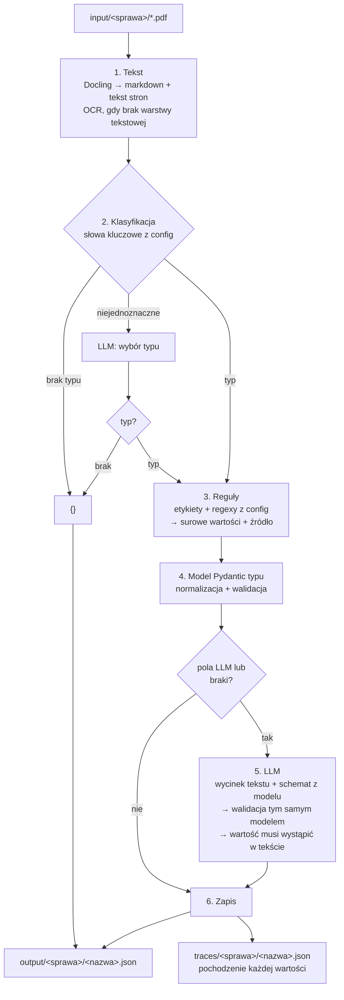
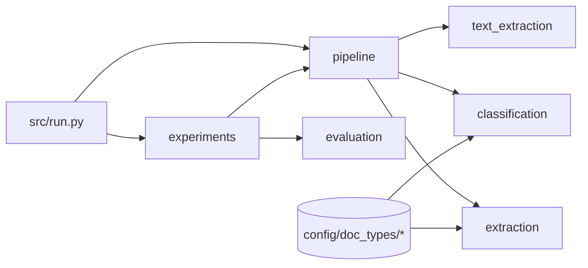
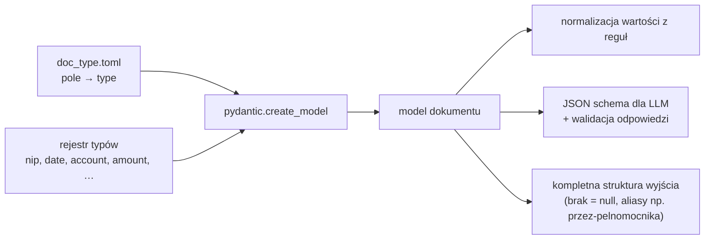
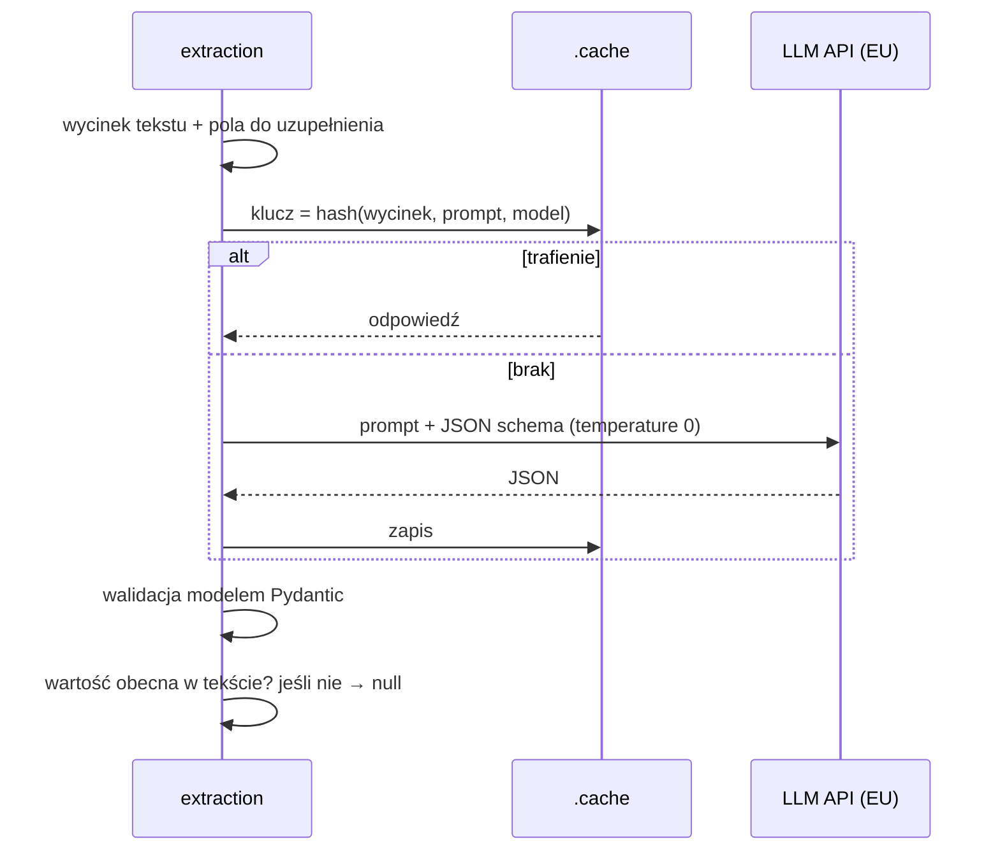
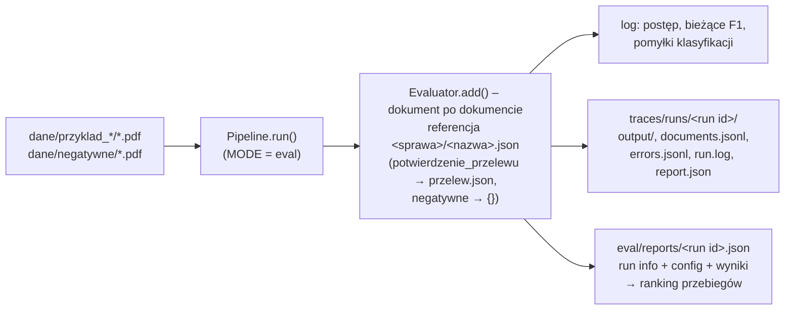

# Architektura Odwołania2json

Docelowa architektura rozwiązania. Wiedza o typach dokumentów jest w `config/`, kod jest ogólny.

## 1. Cel i ograniczenia

- Wejście: `input/<sprawa>/*.pdf` → wyjście: `output/<sprawa>/<ta sama nazwa>.json`.
- Typy: `odwolanie`, `pelnomocnictwo`, `przelew`; każdy inny dokument → `{}`.
- Ocena: F1 na ukrytym zbiorze **realnych** spraw (dane treningowe są syntetyczne), mniejszy LLM = więcej punktów, nowe typy tylko przez konfigurację, przejrzystość ekstrakcji.
- Python 3.13, CPU, 16 GB RAM, LLM przez API w EU/EOG.

Zasada: **reguły najpierw, LLM tylko tam, gdzie potrzebna ocena lub reguły zawiodły.**

## 2. Przepływ dokumentu



Błąd pojedynczego pliku (uszkodzony PDF, błąd API) → log z nazwą pliku, zapis `{}`, kolejny plik.

## 3. Moduły

| Krok | Moduł | Odpowiedzialność |
|---|---|---|
| start | `src/run.py` | ustawienia (`MODE`, `Workspace` ze ścieżkami), lista eksperymentów, logowanie |
| pętla | `src/pipeline/` | `Pipeline` (ABC: `from_config`, `process`; `run` mierzy czas i obsługuje błędy), `PipelineConfig`, `InputDocument`/`DocumentResult` |
| 1 | `src/text_extraction/` | Docling, lokalne modele, OCR, cache konwersji |
| 2 | `src/classification/` | punktacja typów wg słów kluczowych z configu, fallback LLM |
| 3–5 | `src/extraction/` | reguły, typy wartości Pydantic, budowa modelu z configu, wywołanie LLM |
| ewaluacja | `src/evaluation/` | porównanie z referencją, F1 (`Evaluator` liczy przyrostowo) |
| eksperymenty | `src/experiments/` | `Experiment` (klasa pipeline'u + config), `ExperimentRunner`, artefakty przebiegu, historia raportów i ranking |



Przepływ danych jest jednokierunkowy; etapy wymieniają się typowanymi obiektami, nie importują siebie nawzajem.

## 4. Konfiguracja typu dokumentu

```
config/doc_types/<typ>/
  doc_type.toml    # klasyfikacja (słowa kluczowe z wagami); później pola (etykiety, typ wartości, metoda)
  prompt.md        # instrukcja dla LLM (tylko jeśli typ ma pola LLM)
```

Format TOML (`tomllib` ze standardowej biblioteki – bez dodatkowej zależności). Plik jest walidowany modelem Pydantic przy wczytaniu (`src/doc_types.py`); błąd configu zatrzymuje program ze ścieżką pliku. Obecny stan (klasyfikacja) i szkic pól dla przelewu:

```toml
[classification]
min_score = 4                       # minimalna suma wag, by uznać dokument za ten typ

[classification.keywords]           # fraza → waga; ujemna waga = dowód przeciw
"potwierdzenie" = 2
"rachunek odbiorcy" = 3

# faza C – pola:
[fields.kwota]
labels = ["Kwota operacji", "Kwota"]
type = "amount"
```

Klasyfikator (`KeywordClassifier`) szuka fraz na pierwszych `pages` stronach, ignorując wielkość liter i wszystkie białe znaki (tytuły typu „P E Ł N O M O C N I C T W O”); wygrywa typ z najwyższą sumą, jeśli osiąga `min_score` i nie remisuje z innym.

Pola oznaczone `method: llm` (np. `czynnosc_powod_id`) trafiają do LLM zawsze; pozostałe tylko wtedy, gdy reguły nic nie znalazły.

## 5. Model danych (Pydantic)

Jedno miejsce na każdą regułę normalizacji – typy wartości zdefiniowane raz w kodzie:

```python
Nip     = Annotated[str | None,   BeforeValidator(normalize_nip)]      # "999-928-40-65" → "9999284065"
IsoDate = Annotated[str | None,   BeforeValidator(normalize_date)]     # "20 marca 2026" → "2026-03-20"
Account = Annotated[str | None,   BeforeValidator(normalize_account)]  # "PL05 4706…"    → "054706…"
Amount  = Annotated[float | None, BeforeValidator(normalize_amount)]   # "200,00 PLN"    → 200.0
```



Zasady:
- Model budowany z configu (`create_model`), nie pisany ręcznie per typ – nowy typ nie wymaga kodu.
- Wartości nieparsowalne → `None` + powód w trace; jedno złe pole nie odrzuca dokumentu.
- Sumy kontrolne (NIP, REGON, PESEL) nie zerują pól – służą do wyboru między kandydatami. Dane syntetyczne mają ~40% NIP-ów z błędną sumą.
- Pochodzenie wartości (reguła/LLM, strona, fragment) w osobnej strukturze, nie w modelu wyjściowym.

## 6. Reguły vs LLM

| Typ | Reguły | LLM |
|---|---|---|
| klasyfikacja | słowa kluczowe | tylko przy niejednoznacznym wyniku |
| `odwolanie` | data, miejscowość, strony (sekcje „Odwołujący:”/„Zamawiający:”), KRS/NIP/REGON, e-mail, BZP, TED, nr postępowania, tytuł | **`czynnosc_powod_id` + `czynnosc_dzien`** (pierwszy zarzut), lider konsorcjum, `prowadzacy_postepowanie`; fallback dla pól nieznalezionych |
| `pelnomocnictwo` | mocodawca (nazwa, KRS, NIP), `typ`, PESEL | **pełnomocnicy w mianowniku**, podpisujący, wielu mocodawców |
| `przelew` | wszystkie pola (etykieta → wartość) | tylko fallback |
| pola pochodne | `czynnosc_opis` ze słownika po id, `przez-pelnomocnika` z obecności pełnomocnika | – |



Maksymalnie jedno wywołanie LLM na dokument. Klient: SDK `openai` z `base_url` dostawcy (bez LangChain); dostawca i model w ustawieniach, klucz w `.env`.

## 7. Cache, trace, determinizm

- `.cache/` – konwersje Docling i odpowiedzi LLM, klucz = hash pliku/wycinka + ustawienia.
- `traces/` – dla każdego dokumentu: typ i wynik klasyfikacji, każde pole z metodą (`rule`/`llm`/`derived`) i fragmentem źródłowym.
- `output/` – wyłącznie oceniane pliki JSON.
- Deterministycznie: posortowane pliki, temperatura 0, cache.

## 8. Ewaluacja



- Eksperyment = klasa pipeline'u + `PipelineConfig`; lista w `src/run.py`, wybór przez `EVAL_EXPERIMENTS`, szybki podzbiór przez `EVAL_CASES`.
- Raport (commitowany) zawiera commit gita, czas na dokument, pełny config i wyniki; ranking porównuje tylko przebiegi na tym samym zbiorze dokumentów (`dataset_id`).
- Cały zbiór treningowy, bez podziału na dev/holdout (brak uczenia; holdout z tego samego generatora nie mówi nic o realnych danych).
- F1 na polach: JSON spłaszczony do liści `ścieżka → wartość`; trafienie = TP, zła wartość = FP + FN, brak = FN, null po obu stronach pomijany; elementy list dopasowywane po największej zgodności.
- Dwie liczby: **strict** (dokładna równość) i **znormalizowana** – różnica to straty na formatowaniu.
- Ryzyko realnych danych sprawdzamy osobno: wariant „skan” (PDF-y treningowe zrasteryzowane, wymuszony OCR) oraz ręcznie opisane realne dokumenty.

## 9. Dodanie nowego typu dokumentu

1. Utwórz `config/doc_types/<typ>/doc_type.toml`: słowa kluczowe klasyfikacji (później pola z etykietami i typami wartości, struktura JSON).
2. Opcjonalnie `prompt.md` i słowniki, jeśli typ ma pola oceniane przez LLM.
3. Dodaj przykłady z referencjami do `dane/` i uruchom ewaluację.

Kod się nie zmienia, chyba że potrzebny jest nowy rodzaj wartości (np. nowy format identyfikatora) – wtedy jeden normalizator w rejestrze typów.

## 10. Otwarte kwestie

- Negatywne dokumenty: README mówi „pusty plik .json”, przykładowe wyjście organizatora ma 0 bajtów; przyjmujemy `{}` – do potwierdzenia.
- `czynnosc_powod_id` = 12 nie występuje w danych treningowych – opis trzeba ustalić ze specyfikacji.
- `pesel`: w szablonie liczba, w referencjach tekst.
- Dokładny sposób liczenia F1 przez organizatora nie jest opublikowany.
