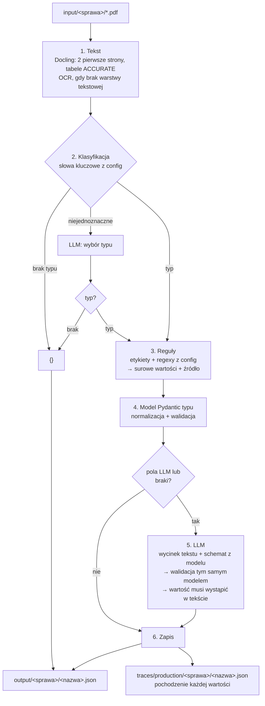
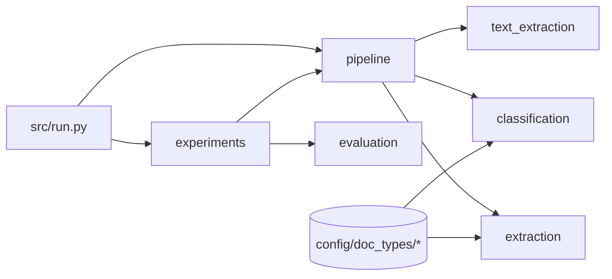
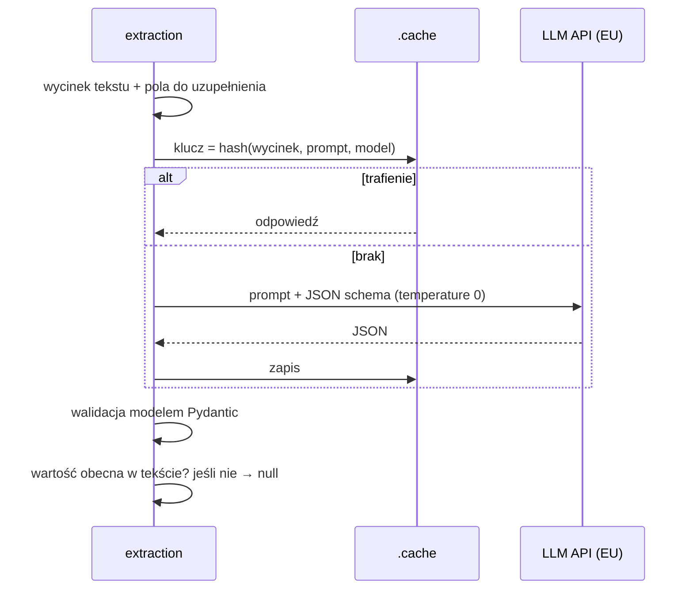
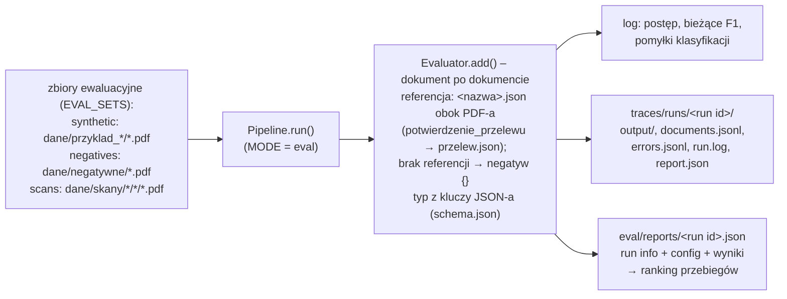

# Architektura Odwołania2json

Docelowa architektura rozwiązania. Wiedza o typach dokumentów jest w `config/`, kod jest ogólny.

## 1. Cel i ograniczenia

- Wejście: `input/<sprawa>/*.pdf` → wyjście: `output/<sprawa>/<ta sama nazwa>.json`.
- Typy: `odwolanie`, `pelnomocnictwo`, `przelew`; każdy inny dokument → `{}`.
- Ocena: F1 na ukrytym zbiorze **realnych** spraw (dane treningowe są syntetyczne), mniejszy LLM = więcej punktów, nowe typy tylko przez konfigurację, przejrzystość ekstrakcji.
- Python 3.13, CPU, 16 GB RAM, LLM przez API w EU/EOG.

Zasada: **reguły najpierw, LLM tylko tam, gdzie potrzebna ocena lub reguły zawiodły.**

## 2. Przepływ dokumentu



Błąd pojedynczego pliku (uszkodzony PDF, błąd API) → log z nazwą pliku, zapis `{}`, kolejny plik.

## 3. Moduły

| Krok | Moduł | Odpowiedzialność |
|---|---|---|
| start | `src/run.py` | ustawienia (`MODE`, `Workspace` ze ścieżkami), lista eksperymentów, logowanie |
| pętla | `src/pipeline/` | `Pipeline` (ABC: `from_config`, `process`; `run` mierzy czas i obsługuje błędy), `PipelineConfig`, `InputDocument`/`DocumentResult` |
| 1 | `src/text_extraction/` | Docling, lokalne modele, OCR, cache konwersji |
| 2 | `src/classification/` | punktacja typów wg słów kluczowych z configu, fallback LLM |
| 3–5 | `src/extraction/` | model wyjścia z `schema.json` (`output_model.py`), reguły z configu (`rule_extractor.py`), zadania LLM z configu (`llm_tasks.py`) |
| ewaluacja | `src/evaluation/` | porównanie z referencją, F1, wartości obecne w tekście, czasy konwersji (`Evaluator` liczy przyrostowo) |
| eksperymenty | `src/experiments/` | `Experiment` (klasa pipeline'u + config), `ExperimentRunner`, artefakty przebiegu, historia raportów i ranking |
| LLM | `src/inference/` | `LlmClient`: API zgodne z OpenAI (PSNC, Bielik-11B), odpowiedzi JSON wg schematu Pydantic, cache odpowiedzi, liczniki tokenów |
| wspólne | `src/cache.py`, `src/doc_types.py`, `src/value_types.py`, `src/workspace.py` | cache dyskowy, wczytywanie `config/doc_types/*`, typy wartości z normalizatorami, ścieżki |



Przepływ danych jest jednokierunkowy; etapy wymieniają się typowanymi obiektami, nie importują siebie nawzajem.

## 4. Konfiguracja typu dokumentu

```
config/doc_types/<typ>/
  doc_type.toml    # klasyfikacja (słowa kluczowe z wagami), sekcje tekstu i reguły pól
  schema.json      # kształt wyjściowego JSON-a 1:1 z oczekiwanym formatem; liście = nazwy typów wartości
  prompt.md        # instrukcja dla LLM (tylko jeśli typ ma pola LLM)
```

Format TOML (`tomllib` ze standardowej biblioteki – bez dodatkowej zależności). Plik jest walidowany modelem Pydantic przy wczytaniu (`src/doc_types.py`): ścieżki pól muszą istnieć w `schema.json`, sekcje i pola, do których reguła się odwołuje, muszą być zdefiniowane, regexy muszą się kompilować; błąd zatrzymuje program ze ścieżką pliku. Przykład (fragmenty z prawdziwych configów):

```toml
[classification]
min_score = 3                                   # minimalna suma wag, by uznać dokument za ten typ
[classification.keywords]                       # fraza → waga; ujemna waga = dowód przeciw
"przelew" = 2

[sections.odwolujacy]                           # część tekstu: od etykiety do etykiety
start = ['odwolujac\w*\s*:']
end = ['zamawiaj\w*\s*:', 'dotyczy']

[fields."przelew_bankowy.z_rachunku"]           # wartość typu (tu: rachunek) po jednej z etykiet
labels = ["z rachunku", "rachunek nadawcy", "zleceniodawca"]
nth = 0                                         # bez etykiety: pierwszy rachunek w tekście

[fields."Odwolujacy[].nazwa"]                   # tekst od początku sekcji do pierwszego cięcia
sections = ["odwolujacy"]
cut = ['\s+ul\.', '\s*\d{2}-\d{3}', '\s+(?:krs|nip|regon)\b']

[fields."mocodawca[].data.typ".classify]        # wartość, której wzorzec pada najwcześniej
osoba_fizyczna = ['prowadzac\w* dzialalnosc', 'ceidg']
osoba_prawna = ['\bsp\.\s?z\s?o\.\s?o\.', '\bkrs\b']
```

Silnik reguł (`src/extraction/rule_extractor.py`) dopasowuje etykiety, sekcje i cięcia do „złożonej” kopii tekstu (małe litery, bez polskich znaków, te same pozycje), więc reguły przeżywają straty OCR; wartości czyta z oryginału i normalizuje typem wartości. Sposoby odczytu pola (`FieldRule`): `lookup` (tabela po wartości wcześniejszego pola, np. opis powodu po kodzie), `classify` (najwcześniej pasujący wzorzec), `labels` (wartość po etykiecie, etykiety w kolejności z configu) albo początek sekcji. Wartość to pierwsza grupa `pattern`, kandydat typu wartości (data, kwota, rachunek, imię i nazwisko …) albo tekst do końca linii (z zawiniętymi liniami). Opcje: `cut`, `skip`, `window`, `multiple` (`segment` – wszystkie osoby po etykiecie, `occurrences` – po każdym wystąpieniu, np. linii kropek pod podpisem), `exclude`, `only_if`, `nth`, `default`. Etykieta konkurencyjnego pola tego samego typu kończy okno – tak rozdzielamy rachunek nadawcy i odbiorcy.

Klasyfikator (`KeywordClassifier`) szuka fraz `keywords` na pierwszych `pages` stronach, a fraz `head_keywords` tylko w nagłówku dokumentu (`head_chars` znaków) – tam dokument mówi, czym jest: orzeczenie KIO zaczyna się od „Sygn. akt … WYROK”, a prawdziwe odwołania cytują orzeczenia dopiero w uzasadnieniu (wykryte na skanach – ujemne słowa w całym tekście odrzucały prawdziwe odwołania). Dopasowanie ignoruje wielkość liter, białe znaki i polskie znaki diakrytyczne (OCR gubi ogonki: „ODWOLANIE”, „Odwołujacy”); wygrywa typ z najwyższą sumą, jeśli osiąga `min_score` i nie remisuje z innym.

Zadania LLM (`[[llm_tasks]]`, model `LlmTaskRule`) to wąskie pytania po regułach, w configu typu: `extract` – odpowiedź o kontekst (pierwsza istniejąca sekcja z listy) dla wskazanych pól, w trybie `decide` (poprawna odpowiedź zastępuje regułę) albo `fill` (tylko puste pola); `nominative` – nazwiska w mianowniku. Schemat odpowiedzi powstaje z typów wartości (kody ograniczone do `choices`), `when` uruchamia zadanie tylko, gdy wzorzec pasuje (np. końcówki przypadków zależnych w nazwiskach). Pola `lookup` (np. opis powodu) są liczone ponownie po LLM.

## 5. Model danych (Pydantic)

Jedno miejsce na każdą regułę normalizacji: typy wartości w `src/value_types.py` (`VALUE_TYPES`). Każdy ma typ Pythona, normalizator i informację, czy dokumenty zapisują wartość wprost (kody, flagi i opisy ze słownika są interpretowane). Liście `schema.json` nazywają te typy; nieznana nazwa zatrzymuje wczytywanie configu.

| Typ | Normalizacja (przykład) |
|---|---|
| `date` | „24 września 2026 r.”, `24.09.2026`, `24/09/2026` → `2026-09-24`; niepoprawna data → null |
| `amount` | „15 000,00 zł”, `15.000,00` → `15000.0` |
| `nip`, `regon`, `krs`, `pesel` | same cyfry o właściwej długości; KRS uzupełniany zerami do 10 cyfr |
| `account` | same cyfry, bez prefiksu `PL` (konwencja 138 ze 140 referencji) |
| `ted`, `bzp` | `2026/S 245-999449` → `999449-2026`; `2026/BZP 00999778/03` → `2026/BZP00999778/03` |
| `person_name` | bez tytułów i funkcji („adw.”, „r. pr.”, „Prezes Zarządu”), WERSALIKI → „Jan Kowalski” |
| `email`, `text` | e-mail małymi literami; tekst z pojedynczymi spacjami, bez cudzysłowów wokół |
| `flag`, `reason_id`, `party_type`, `reason_description` | 0/1; 1–12; `osoba_prawna`/`osoba_fizyczna`; tekst |


Rozpoznany dokument zawsze dostaje pełną strukturę (`SkeletonExtractor`: wszystkie wartości null, jeden element na listę, jak w szablonach organizatora); ekstraktory ją wypełniają. Sprawdzenie: wszystkie 2704 wartości z referencji przechodzą przez modele bez zmian, poza 2 numerami rachunków ze skanów zapisanymi z `PL`.

Zasady:
- Model budowany z `schema.json` (`create_model`), nie pisany ręcznie per typ – nowy typ dokumentu nie wymaga kodu.
- Wartości nieparsowalne → `None` + powód w trace; jedno złe pole nie odrzuca dokumentu.
- Sumy kontrolne (NIP, REGON, PESEL) nie zerują pól – służą do wyboru między kandydatami. Dane syntetyczne mają ~40% NIP-ów z błędną sumą.
- Pochodzenie wartości (reguła/LLM, strona, fragment) w osobnej strukturze, nie w modelu wyjściowym.

## 6. Reguły vs LLM

Wyniki (226 dokumentów, strict):

| Eksperyment | F1 | syntetyczne | skany | odwołanie | pełnomocnictwo | przelew | LLM (zimny przebieg) |
|---|---|---|---|---|---|---|---|
| `rules-v1` (same reguły) | 0,950 | 0,969 | 0,822 | 0,959 | 0,921 | 0,958 | – |
| `hybrid-v1` (reguły + Bielik-11B) | **0,954** | **0,973** | 0,822 | **0,965** | 0,921 | 0,958 | 70 wywołań, 182 tokeny i ~0,1 s na dokument |

Negatywy: bez wymyślonych wartości w obu. LLM w `hybrid-v1`: kod powodu na zdaniu „Zamawiający w dniu … <czynność>.” (sekcja kończy się na zdaniu – kolejne zdania „Wcześniej, w dniu …” i treść zarzutów myliły model: F1 kodu 0,47 → 0,56 → 0,92); syntetyczne kody wszystkie poprawne, 6 błędów na skanach jak w regułach (skany nie mają zdania o czynności; lista zaskarżonych czynności jako kontekst dała 0,37). Mianownik nazwisk: na danych syntetycznych nie uruchamia się (nazwiska są w mianowniku). Pola poniżej 0,9:

| Pole | F1 | Przyczyna | Dalej |
|---|---|---|---|
| `Zamawiajacy[].prowadzacy_postepowanie` | 0,00 | ustawiane tylko przy kilku zamawiających (2 z 60 odwołań); reguły biorą pierwszego | LLM: wiele podmiotów |
| `mocodawca[].podpisujacy[]` | 0,82 | konsorcja (podpisy kilku mocodawców), nazwiska w układach kolumnowych | LLM |
| `czynnosc_powod_id`, `czynnosc_opis` | 0,86 → 0,92 z LLM | reguły: „odpowiedzi do SWZ” vs „publikacja SWZ”, zaniechanie unieważnienia (przyklad_49/58); oba: skany bez zdania „Zamawiający w dniu” | LLM na zdaniu o czynności (`hybrid-v1`) |

Pozostałe straty: drugi mocodawca/odwołujący w konsorcjach, kolejność kolumn w 2 układach przelewów, błędy OCR na skanach (wartości w tekście 0,85–0,97), konwencja `PL` w 2 rachunkach ze skanów, rachunek UZP w 2 skanach przelewów, którego nie ma w tekście.

| Typ | Reguły | LLM |
|---|---|---|
| klasyfikacja | słowa kluczowe | tylko przy niejednoznacznym wyniku |
| `odwolanie` | data, miejscowość, strony (sekcje „Odwołujący:”/„Zamawiający:”), KRS/NIP/REGON, pełnomocnik, e-mail, BZP, TED, nr postępowania, tytuł, data i powód czynności (wzorce) | **powód zaskarżenia** przy niepewnych wzorcach, kilku zamawiających |
| `pelnomocnictwo` | mocodawca (nazwa z formą prawną, KRS, NIP, typ), pełnomocnicy, podpisujący, PESEL | **mianownik nazwisk**, konsorcja |
| `przelew` | wszystkie pola (etykieta → wartość) | tylko fallback |
| pola pochodne | `czynnosc_opis` ze słownika po kodzie, `przez-pelnomocnika` z obecności pełnomocnika | – |



Klient: `LlmClient` (SDK `openai` z `base_url` dostawcy, bez LangChain); endpoint i model w `LlmSettings` (`src/run.py`), klucz w `.env`. Odpowiedzi w JSON wg schematu, z instrukcją „zwarty JSON w jednej linii” (bez niej małe modele produkowały puste znaki do limitu), `max_tokens` 200, jedna ponowna próba przy złej odpowiedzi; w cache trafiają tylko odpowiedzi poprawne (i są ponownie walidowane przy odczycie). Wpis w `.cache/llm/` przechowuje zapytanie, odpowiedź, tokeny i czas – każdą wartość z LLM można odtworzyć do promptu, a raport pokazuje koszt zimnego przebiegu. Niezawodność: wartość pisana musi wystąpić w kontekście, nazwisko po zmianie musi zachować rdzenie słów, błąd zostawia wartość z reguł; po 3 nieudanych żądaniach z rzędu (np. awaria API) klient przestaje wołać model do końca przebiegu – zostają same reguły.

## 7. Konwersja i budżet czasu

Ustawienia (`ConversionSettings`, wybrane pomiarem): pierwsze **2 strony**, TableFormer **ACCURATE**, RapidOCR (pl) tylko na stronach bez warstwy tekstowej, 4 wątki CPU. Pomiar: zimne konwersje wszystkich 226 dokumentów, Apple M4, tylko CPU.

| Pytanie | Wynik | Decyzja |
|---|---|---|
| Na których stronach są wartości z referencji? | strona 1; wyjątek: `czynnosc_dzien` na stronie 2 (5/60 syntetycznych, 3/10 skanów); strony 3–4 nic nie dodają | `max_pages = 2`: skan odwołania 12,6–13,7 s → 5,9–6,9 s |
| Tabele: FAST / ACCURATE / bez struktury | wartości w tekście: ACCURATE i „bez struktury” identycznie w każdym polu; FAST gubi 6 (rozbite komórki przelewów, podpisujący) | ACCURATE: wiersze „etykieta \| wartość” dla reguł, koszt ~0,1 s/PDF |
| Czas na dokument | warstwa tekstowa 0,3–0,5 s; skan 1-stronicowy 2,2–2,6 s; skan odwołania 5,6 s (2,8 s/stronę); ładowanie modeli ~5 s raz na przebieg | – |
| Pamięć | szczyt ~4,8 GB | mieści się w 16 GB |

Projekcja 150 PDF-ów (50 spraw × odwołanie, pełnomocnictwo, przelew), sama konwersja: **1,0 min** bez skanów, 3,6 min przy 1/3 skanów, **8,6 min**, gdy wszystko jest skanem. Limit to 45 min, nasz cel ≤ 30 min: zostaje zapas na ~3× wolniejszy laptop i wywołania LLM, równoległość nie jest potrzebna.

Jakość OCR: wartości w tekście na skanach 0,85 (przelew) – 0,97 (pełnomocnictwo) wobec 0,996–1,000 w PDF-ach z warstwą tekstową. Braki to błędy znaków (zgubione ogonki: „opłata” → „oplata”, pomylone litery: „pełnomocnictwa” → „peinomocnectwa”), nie układ strony. Kandydat na osobny eksperyment: większy model rozpoznawania PP-OCRv6 (obecnie `small`) – budżet czasu na to pozwala.

## 8. Cache, trace, determinizm

- `.cache/` – konwersje Docling i odpowiedzi LLM, klucz = hash pliku/wycinka + ustawienia.
- `traces/` – dla każdego dokumentu (`traces/production/<sprawa>/<plik>.json` w trybie run, `traces/runs/<przebieg>/traces/` w ewaluacji): status i czas konwersji, wyniki klasyfikacji wszystkich typów oraz każda wartość z pochodzeniem – źródło (`rule`/`llm`/`derived`/`default`), konkretna reguła (etykieta, wzorzec, klasa) lub zadanie LLM, strona i fragment tekstu. Przykład:

  ```json
  {"path": "OdwolanieKIO.czynnosc_powod_id", "value": 8, "source": "llm", "detail": "task contested_action",
   "page": 2, "snippet": "Zamawiający w dniu 23 sierpnia 2026 roku przekazał informację o wyniku postępowania, z której wynika, że zaniechał wykluczenia wykonawcy …"}
  ```

  Sprawdzenie: wszystkie 2262 niepuste wartości wyjściowe (226 dokumentów, `rules-v1` i `hybrid-v1`) mają wpis w trace z tą samą wartością; stronę i fragment ma każda poza wartością domyślną.
- `output/` – wyłącznie oceniane pliki JSON.
- Deterministycznie: posortowane pliki, temperatura 0, cache.

## 9. Ewaluacja



- Eksperyment = klasa pipeline'u + `PipelineConfig`; lista w `src/run.py`, wybór przez `EVAL_EXPERIMENTS`, szybki podzbiór przez `EVAL_CASES`.
- Zbiory ewaluacyjne (`EVAL_SETS`): `synthetic` (przykłady z warstwą tekstową, w tym negatywy wewnątrz spraw), `negatives`, `scans` (skany – ścieżka OCR). Wyniki raportowane osobno dla każdego zbioru (`by_subset`), żeby słabość jednego rodzaju wejścia nie ginęła w średniej.
- Referencja to `<nazwa>.json` obok PDF-a; PDF bez referencji to negatyw (organizator umieszcza je też wewnątrz spraw). Oczekiwany typ rozpoznajemy po kluczach najwyższego poziomu (zgodnie z `schema.json`), nie po nazwie pliku – README: nazwy plików mogą być dowolne.
- Raport (commitowany) zawiera commit gita, czas na dokument, pełny config, snapshot `config/doc_types/*` i wyniki; ranking porównuje tylko przebiegi na tym samym zbiorze dokumentów (`dataset_id`).
- Cały zbiór treningowy, bez podziału na dev/holdout (brak uczenia; holdout z tego samego generatora nie mówi nic o realnych danych).
- F1 na polach: JSON spłaszczony do liści `ścieżka → wartość`; trafienie = TP, zła wartość = FP + FN, brak = FN, null po obu stronach pomijany; elementy list dopasowywane po największej zgodności.
- Dwie liczby: **strict** (dokładna równość) i **znormalizowana** – różnica to straty na formatowaniu.
- **Wartości w tekście** („in text”, `coverage`): udział wartości referencyjnych obecnych w wyciągniętym tekście, w typowych zapisach (daty `24.09.2026`/`24 września 2026`, kwoty `15 000,00`, identyfikatory jako ciąg cyfr, TED także jako `2026/S 245-999449`). To sufit ekstrakcji z tego tekstu i kontrola konwersji – rozbite komórki tabel i błędy OCR widać przed napisaniem reguł. Typ wartości pola bierzemy z `schema.json`; pola interpretowane (`reason_id`, `reason_description`, `flag`, `party_type`) pomijamy.
- **Czas zimnego przebiegu**: czas konwersji każdego PDF-a jest zapisywany w cache razem z konwersją, więc raport pokazuje średni i maksymalny czas na dokument w każdym zbiorze również przy ciepłym cache.
- Ryzyko realnych danych sprawdzamy osobno: zbiór `scans` organizatora (ścieżka OCR), opcjonalnie ręcznie opisane realne dokumenty.

## 10. Dodanie nowego typu dokumentu

1. Utwórz `config/doc_types/<typ>/doc_type.toml` (słowa kluczowe klasyfikacji; później reguły pól) i `schema.json` (struktura wyjścia, w liściach nazwy typów wartości z `src/value_types.py`).
2. Opcjonalnie `prompt.md` i słowniki, jeśli typ ma pola oceniane przez LLM.
3. Dodaj przykłady z referencjami do `dane/` i uruchom ewaluację.

Kod się nie zmienia, chyba że potrzebny jest nowy rodzaj wartości (np. nowy format identyfikatora) – wtedy jeden normalizator w `VALUE_TYPES`.

## 11. Otwarte kwestie

- Negatywne dokumenty: README mówi „pusty plik .json”, przykładowe wyjście organizatora ma 0 bajtów; przyjmujemy `{}` – do potwierdzenia.
- Słownik `czynnosc_powod_id` (1–12) jest w `dane/oczekiwane-json/czynnosc_powod_id_dict.md`; 12 = „Projektowane postanowienia umowy” nie występuje w danych treningowych.
- `z_rachunku`/`na_rachunek`: referencje treningowe bez prefiksu `PL`, 2 z 10 skanów z prefiksem; normalizator idzie za większością (bez `PL`) – do zmiany, jeśli organizator wskaże inaczej.
- Organizator zapowiada zmianę sposobu oceny (README, „stay tuned”) – limit czasu: 150 PDF-ów w 45 minut (projekcja w sekcji 7).
- `pesel`: w szablonie liczba, w referencjach tekst.
- Dokładny sposób liczenia F1 przez organizatora nie jest opublikowany.
